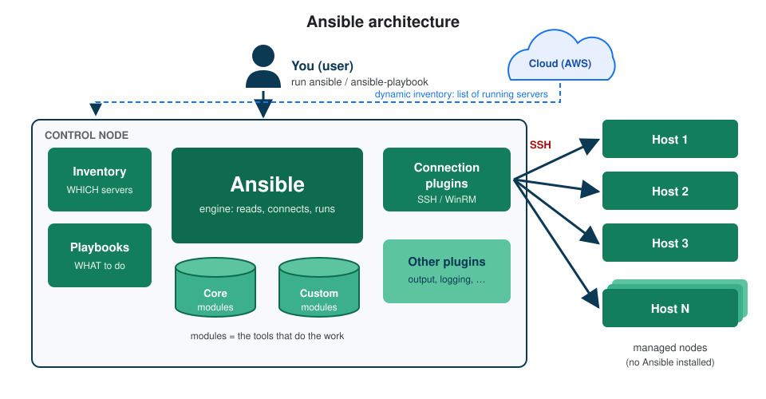
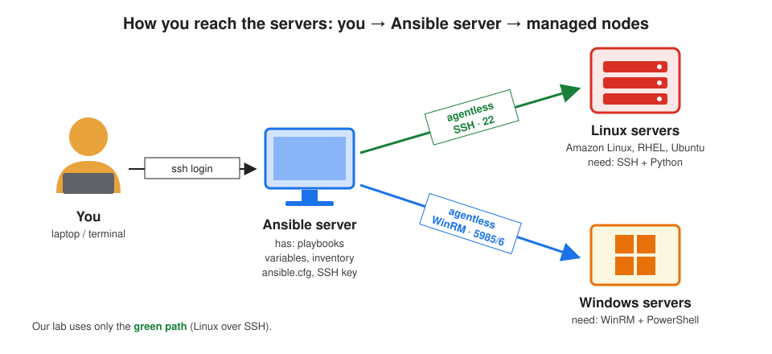
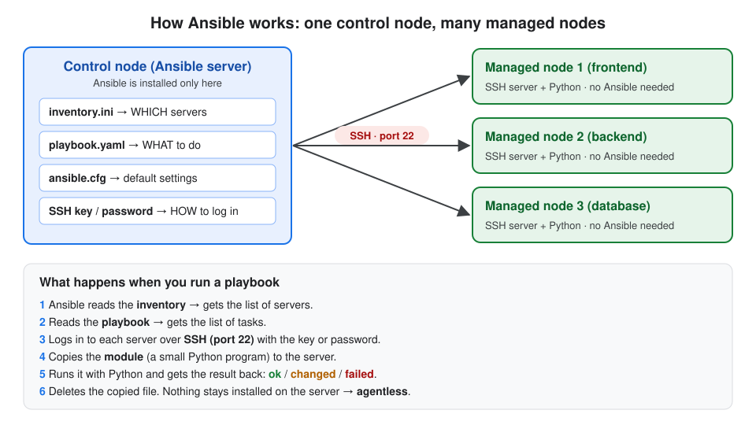
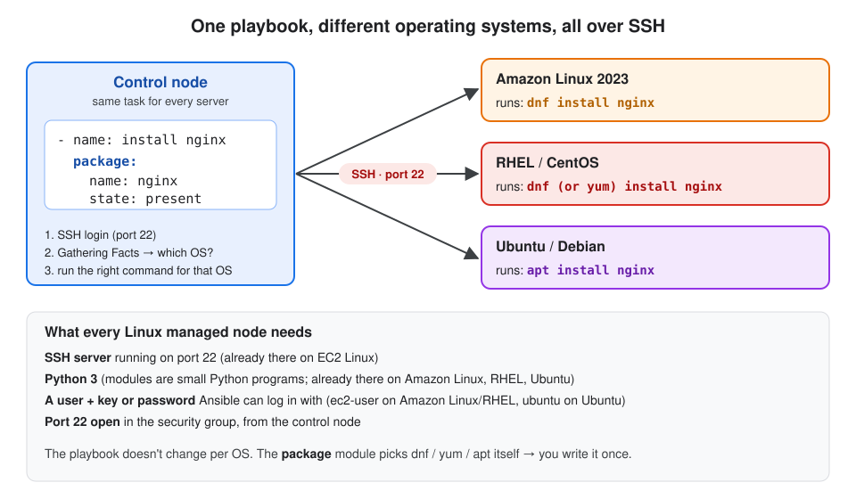

# 1. Introduction to Ansible

## About this topic

What Ansible is, why we need it, its parts, and how it reaches servers over SSH to do the work.

| Part | Topic |
|---|---|
| **Part 1: Concepts** | what Ansible is · uses · key features · key terms · architecture · how it connects · different OS · workflow · real-world use cases |
| **Part 2: Lab** | install Ansible · run the first ad-hoc command |

[← Back to all topics](../README.md) · Next: [2. Inventory →](../02-inventory/README.md)

## Table of Contents

**Part 1: Concepts**
1. [What is Ansible?](#1-what-is-ansible)
2. [Key features](#2-key-features)
3. [Key terms](#3-key-terms)
4. [Architecture](#4-architecture)
5. [How Ansible connects to servers](#5-how-ansible-connects-to-servers)
6. [Different operating systems, one playbook](#6-different-operating-systems-one-playbook)
7. [Workflow](#7-workflow)
8. [Real-world use cases](#8-real-world-use-cases)

**Part 2: Lab**
- [Step 1: Install Ansible](#step-1-install-ansible)
- [Step 2: First ad-hoc command](#step-2-first-ad-hoc-command)

[What I learned](#what-i-learned)

---

# Part 1: Concepts

## 1. What is Ansible?

**Definition:** **Ansible** = an **open-source automation tool**. It sets up servers automatically: installs packages, creates users, copies files, starts services. You describe the work in **playbooks** written in **YAML**.

To run any application you need **2 things**:

| # | Part | What it is | Who handles it |
|---|---|---|---|
| 1 | **Code** | the application (Java, Node.js, Python files) | developers, kept in Git |
| 2 | **Configuration** | everything on the server so the code can run: packages, users, folders, services | **Ansible** |

**Before vs after Ansible:**

```
Before:  you ──ssh──► server 1  (type 20 commands)
         you ──ssh──► server 2  (type the same 20 commands again)
         you ──ssh──► server 3  (... and again, and hope you didn't miss one)

After:   you ──► ansible-playbook setup.yaml ──SSH──► server 1, 2, 3 ... 100  (same result on all)
```

**What Ansible is used for:**

| Use | Example |
|---|---|
| **Configuration management** | install nginx, create users, set up config files |
| **Application deployment** | copy the app to servers and restart it |
| **Provisioning** | create servers (e.g. EC2 instances) |
| **Orchestration** | do steps across many servers in the right order: database → backend → frontend |

## 2. Key features

| Feature | One-line meaning |
|---|---|
| **Agentless** | nothing installed on managed servers; uses SSH (Linux) or WinRM (Windows) |
| **Idempotent** | running it many times gives the same result; if nginx is already running, it won't start it again |
| **Declarative** | you write **what** you want ("nginx should be installed"), Ansible decides **how** |
| **Simple** | playbooks are YAML, readable like English |
| **Extensible** | thousands of ready modules, and you can write your own in Python |

**Why not just a shell script?**

| Shell script | Ansible |
|---|---|
| runs on one server at a time | runs on **many servers in parallel** |
| you write `if` checks ("already installed?") | checks are built in (**idempotent**) |
| `dnf` on one OS, `apt` on another: two scripts | one playbook works on any Linux OS |
| running twice can break things | safe to run again and again |

## 3. Key terms

**Definition:** the basic words you'll see everywhere in Ansible, one line each.

| Term | One-line definition |
|---|---|
| **Control node** | the machine where Ansible is installed and run from |
| **Managed node** (host) | a server Ansible configures (needs only SSH + Python) |
| **Agentless** | nothing is installed on managed nodes; Ansible just uses SSH |
| **Inventory** | the file that lists the servers Ansible manages |
| **Group** | a name for a set of hosts in the inventory (`[webservers]`) |
| **Module** | a small program that does one job (`package`, `service`, `user`) |
| **Collection** | a package of modules (`ansible.builtin`, `amazon.aws`) |
| **Task** | one step in a playbook; runs one module |
| **Play** | a set of tasks for a set of hosts |
| **Playbook** | a YAML file with one or more plays |
| **Ad-hoc command** | run one module from the command line, no playbook (`ansible all -m ping`) |
| **Facts** | info Ansible collects about a server (OS, IP, memory) |
| **Variable** | a name that stores a value, used as `{{ name }}` |
| **Handler** | a task that runs only when another task **changed** something (e.g. restart nginx) |
| **Role** | a ready folder structure that groups tasks, variables and files for reuse |
| **Plugin** | adds features to Ansible itself (SSH connection, output display, dynamic inventory) |
| **`ansible.cfg`** | Ansible's settings file (default inventory, SSH user, key) |

## 4. Architecture

**Definition:** **Ansible architecture** = the parts Ansible is made of and how they work together. Everything lives on the **control node**; managed nodes need nothing extra.



| Part | Job |
|---|---|
| **Control node** | where Ansible runs. Your laptop (Linux/Mac) or a server. **Windows can't be a control node.** |
| **Inventory** | WHICH servers (a file you write, or fetched from AWS = dynamic) |
| **Playbooks** | WHAT to do |
| **Ansible engine** | reads both, connects, runs the tasks |
| **Modules** | the tools that do the work. **Core** (come with Ansible) or **custom** (you write them) |
| **Connection plugins** | how to reach hosts: SSH (Linux) or WinRM (Windows) |
| **Other plugins** | output display, logging, dynamic inventory |
| **Managed nodes (hosts)** | servers, VMs, cloud instances, network devices |

## 5. How Ansible connects to servers

**Definition:** Ansible **pushes** work to servers: it logs in over **SSH**, copies a small program (the module), runs it, and removes it.

**You → Ansible server → managed nodes:**



| | Control node | Managed node |
|---|---|---|
| Ansible installed? | ✅ yes | ❌ no |
| What it has | inventory, playbooks, SSH key/password | SSH server + Python |
| Connection | starts SSH (port 22) | accepts SSH (port 22) |

**What happens when you run a playbook:**



> In one line: **Ansible = SSH + Python + a list of tasks.**

## 6. Different operating systems, one playbook

Ansible logs in over SSH to every Linux server the same way. During **Gathering Facts** it finds out the OS, then runs the right command for it.



| Managed node OS | Login user (on AWS) | `package` module uses |
|---|---|---|
| Amazon Linux 2023 | `ec2-user` | `dnf` |
| RHEL / CentOS | `ec2-user` | `dnf` (older: `yum`) |
| Ubuntu / Debian | `ubuntu` | `apt` |

## 7. Workflow

**Definition:** **Workflow** = the order of steps from writing the files to a configured server.

```
1. Write the inventory     (WHICH servers)          inventory.ini
          │
2. Write the playbook      (WHAT to do)             site.yaml
          │
3. Run it                  ansible-playbook -i inventory.ini site.yaml
          │
4. Connect                 logs in to each server over SSH
          │
5. Gather facts            collects OS, IP, CPU of each server
          │
6. Run the modules         copies each module to the server, runs it, deletes it
          │
7. Read the result         PLAY RECAP: ok / changed / failed
```

## 8. Real-world use cases

| Use case | What teams do with Ansible |
|---|---|
| **Cloud provisioning** | launch EC2 instances, set up networking, deploy the app the same way in dev, test and prod |
| **Configuration management** | keep hundreds of servers set up the same way (packages, users, config files) |
| **Application deployment / CI/CD** | a pipeline runs a playbook: pull the new code, deploy it, restart the service |
| **Security and compliance** | apply patches, enforce password and SSH policies on every server |
| **Network automation** | configure routers, switches and firewalls (VLANs, rules) |
| **Disaster recovery** | rebuild a failed server from a playbook in minutes |

---

# Part 2: Lab

> Run on an **Amazon Linux 2023** EC2 instance (or any Linux machine). This machine becomes your **control node**.

### Step 1: Install Ansible

```bash
sudo dnf install ansible-core -y
```

**What it does:** installs Ansible (the engine + built-in modules). On Ubuntu use `sudo apt install ansible -y`.

```bash
ansible --version
```

**What it does:** confirms the install.
**Expected:**

```
ansible [core 2.15.x]
  config file = None
  python version = 3.9.x
```

| Line | Means |
|---|---|
| `ansible [core 2.15.x]` | Ansible is installed |
| `config file = None` | no `ansible.cfg` yet (defaults are used) |
| `python version` | the Python that Ansible itself runs on |

### Step 2: First ad-hoc command

```bash
ansible localhost -m ping
```

**What it does:** runs the `ping` module on this same machine (`localhost`). `-m` = which module. It doesn't send a network ping; it checks Ansible can run Python there.
**Expected:**

```
localhost | SUCCESS => {
    "changed": false,
    "ping": "pong"
}
```

> You'll see `[WARNING]: No inventory was parsed, only implicit localhost is available`. That's fine: we have no inventory yet. Topic 2 creates one.

```bash
ansible localhost -m command -a "uptime"
```

**What it does:** runs the Linux `uptime` command through Ansible. `-a` = the arguments for the module.
**Expected:** `localhost | CHANGED | rc=0 >>` and the uptime line.

---

## What I learned

- **Ansible** automates server setup over **SSH**, from one **control node**, with nothing installed on the **managed nodes** (agentless).
- It's **declarative** (say what you want) and **idempotent** (safe to run again).
- **Architecture:** inventory (which) + playbooks (what) + modules (tools) + connection plugins (SSH/WinRM).
- **Workflow:** inventory → playbook → `ansible-playbook` → SSH → facts → modules → PLAY RECAP.
- The `package` module makes one playbook work on Amazon Linux (`dnf`) and Ubuntu (`apt`).

```
inventory (WHICH) ──┐
                    ├──► ansible-playbook ──SSH──► servers configured
playbook (WHAT) ────┘
```

[← Back to all topics](../README.md) · Next: [2. Inventory →](../02-inventory/README.md)
