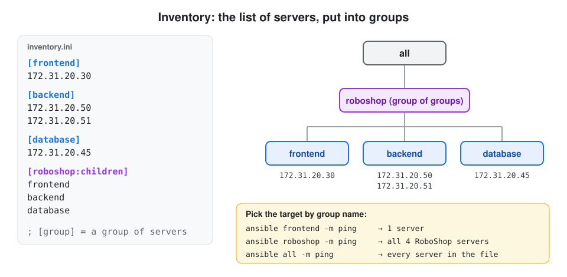
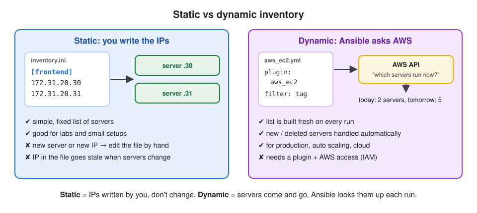

# 2. Inventory

## About this topic

The inventory tells Ansible **which servers** to manage. Here we learn how to write one, group servers, add variables, and the difference between **static** and **dynamic** inventory.

| Part | Topic |
|---|---|
| **Part 1: Concepts** | what an inventory is · key terms · INI format · groups of groups · host and group variables · YAML format · static vs dynamic · how to test |
| **Part 2: Lab** | build a YAML inventory · check it · print each host's variables with a playbook |

[← 1. Introduction](../01-introduction/README.md) · [All topics](../README.md) · Next: [3. Modules →](../03-modules/README.md)

## Table of Contents

**Part 1: Concepts**
1. [What is an inventory?](#1-what-is-an-inventory)
2. [Key terms](#2-key-terms)
3. [INI format](#3-ini-format)
4. [Inventory variables](#4-inventory-variables)
5. [YAML format](#5-yaml-format)
6. [Static vs dynamic inventory](#6-static-vs-dynamic-inventory)
7. [How to test an inventory](#7-how-to-test-an-inventory)

**Part 2: Lab**
- [Step 1: Create the project folder](#step-1-create-the-project-folder)
- [Step 2: Write the inventory](#step-2-write-the-inventory)
- [Step 3: Check the inventory](#step-3-check-the-inventory)
- [Step 4: Print the variables with a playbook](#step-4-print-the-variables-with-a-playbook)

[What I learned](#what-i-learned)

---

# Part 1: Concepts

## 1. What is an inventory?

**Definition:** **Inventory** = a file (or a script/plugin) that lists the **hosts** Ansible manages, put into **groups**. It answers: **who** will Ansible work on?



**Where Ansible looks for it:**

| Way | Example |
|---|---|
| `-i` on the command line (wins) | `ansible all -i inventory.ini -m ping` |
| `inventory =` in `ansible.cfg` | `inventory = ./inventory.ini` |
| default file | `/etc/ansible/hosts` |

## 2. Key terms

| Term | One-line definition |
|---|---|
| **Host** | one managed machine: a server, VM, cloud instance or network device |
| **Group** | a name for a set of hosts, so one command can target all of them |
| **Group of groups** | a group made of other groups (`[production:children]`) |
| **Host variable** | a value for one host only (e.g. its SSH user) |
| **Group variable** | a value for every host in a group |
| **Static inventory** | a fixed list of hosts that you write by hand |
| **Dynamic inventory** | the host list is fetched at run time from a source like the AWS API |

## 3. INI format

**Definition:** **INI format** = the simplest inventory style: `[group]` headings with one host per line.

```ini
[webservers]
web1.example.com
web2.example.com

[databases]
db1.example.com
db2.example.com

[production:children]
webservers
databases
```

| Part | Means |
|---|---|
| `[webservers]` | a group called `webservers` |
| `web1.example.com` | a host (hostname or IP) |
| `[production:children]` | a **group of groups**: production = webservers + databases |
| `#` or `;` | a comment |

**Built-in groups** (you don't write them, they always exist):

| Group | Contains |
|---|---|
| `all` | every host in the inventory |
| `ungrouped` | hosts written without any `[group]` above them |

**Target what you need:**

| Command | Runs on |
|---|---|
| `ansible webservers -m ping` | web1, web2 |
| `ansible production -m ping` | all 4 hosts |
| `ansible all -m ping` | every host |
| `ansible web1.example.com -m ping` | just one host |

## 4. Inventory variables

**Definition:** **Inventory variables** = values written in the inventory, for one host (**host variables**) or a whole group (**group variables**). Playbooks can use them without changing any code.

**Host variables:** on the same line as the host.

```ini
[webservers]
web1 ansible_host=192.168.1.10 ansible_user=ubuntu   http_port=80
web2 ansible_host=192.168.1.11 ansible_user=ec2-user http_port=8080 ansible_port=2222

[databases]
db1 ansible_host=192.168.1.20 ansible_user=admin ansible_ssh_private_key_file=/home/admin/.ssh/id_rsa
```

**Group variables:** under `[group:vars]`, applied to every host in the group.

```ini
[webservers:vars]
app_env=production
```

**Connection variables** (built-in names that tell Ansible **how to log in**):

| Variable | Means | Default |
|---|---|---|
| `ansible_host` | the real IP/hostname to connect to (when `web1` is just a short name) | the inventory name |
| `ansible_user` | SSH username | your current user |
| `ansible_port` | SSH port | 22 |
| `ansible_ssh_private_key_file` | private key to log in with | `~/.ssh/id_rsa` etc. |
| `ansible_password` | SSH password (avoid; prefer keys) | none |
| `ansible_connection` | how to connect: `ssh` or `local` (run on this machine) | `ssh` |

`http_port` and `app_env` are **your own** variables: any name you choose, used in playbooks as `{{ http_port }}`.

## 5. YAML format

**Definition:** the same inventory can be written in **YAML**. It's longer, but the structure is very clear.

```yaml
all:
  children:
    webservers:
      hosts:
        web1:
          ansible_host: 192.168.1.10
          http_port: 80
        web2:
          ansible_host: 192.168.1.11
          http_port: 8080
      vars:
        app_env: production
    databases:
      hosts:
        db1:
          ansible_host: 192.168.1.20
    production:
      children:
        webservers:
        databases:
```

| Keyword | Means |
|---|---|
| `all:` | the top group: every host |
| `children:` | the groups inside a group |
| `hosts:` | the hosts in a group, each with its own variables |
| `vars:` | group variables for every host in that group |

| | INI | YAML |
|---|---|---|
| Looks like | `[group]` + lines | nested `key: value` |
| Best for | small, simple inventories | big inventories with many variables |
| File name | `inventory.ini` | `inventory.yaml` |

## 6. Static vs dynamic inventory



| | **Static inventory** | **Dynamic inventory** |
|---|---|---|
| **Definition** | a file with a **fixed list** of hosts, written by you | the host list is **fetched at run time** from a source like AWS |
| IPs | don't change | servers come and go, so IPs keep changing |
| Updating | edit the file by hand | automatic, on every run |
| Format | INI or YAML file | inventory **plugin** config (or an older script) |
| Used for | labs, small or stable setups | **production**, cloud, auto scaling |

**Dynamic inventory on AWS** (`aws_ec2.yaml`): instead of IPs, you tell Ansible **how to find** the servers.

```yaml
plugin: amazon.aws.aws_ec2
regions:
  - us-east-1
filters:
  tag:Project: roboshop
  instance-state-name: running
keyed_groups:
  - key: tags.Name
    prefix: ""
```

| Line | Means |
|---|---|
| `plugin: amazon.aws.aws_ec2` | use the AWS EC2 inventory plugin |
| `regions` | which AWS region to look in |
| `filters` | only running servers tagged `Project=roboshop` |
| `keyed_groups` | make a group from each server's `Name` tag (e.g. `frontend`) |

```bash
ansible-inventory -i aws_ec2.yaml --graph
```

**What it does:** asks AWS for the matching servers right now and shows them as groups. A new server with the same tag appears on the next run, with no file to edit.

> Needs the `amazon.aws` collection, the `boto3` Python library and AWS access (an IAM role or keys) on the control node.

**Older way: inventory scripts.** Before plugins, a dynamic inventory was a script (often Python) that printed the hosts as JSON. Plugins replaced them; you'll still see scripts in old projects.

```json
{
  "webservers": { "hosts": ["web1", "web2"], "vars": { "app_env": "production" } },
  "databases":  { "hosts": ["db1"] }
}
```

## 7. How to test an inventory

| Command | Shows |
|---|---|
| `ansible-inventory -i <inventory> --graph` | groups and hosts as a tree |
| `ansible-inventory -i <inventory> --graph --vars` | the tree with each host's variables |
| `ansible-inventory -i <inventory> --list` | everything as JSON |
| `ansible-inventory -i <inventory> --host web1` | the variables of one host |
| `ansible <group> -i <inventory> -m ping` | checks Ansible can actually log in (`pong`) |

> `ansible-inventory` only **reads the file**. Only `-m ping` proves the network, SSH user and key work.

---

# Part 2: Lab

> We make an inventory with 4 hosts (`web1`, `web2`, `db1`, `db2`). To run it on **one machine**, every host uses `ansible_connection: local`, so Ansible runs on localhost but treats them as 4 different hosts with their own variables.

### Step 1: Create the project folder

```bash
mkdir -p ~/ansible-notes-lab/inventory-lab
```

**What it does:** creates a folder for this lab.

```bash
cd ~/ansible-notes-lab/inventory-lab
```

### Step 2: Write the inventory

```bash
vim inventory.yaml
```

**What it does:** opens a new file. Press `i` and type:

```yaml
all:
  vars:
    ansible_connection: local
  children:
    webservers:
      hosts:
        web1:
          http_port: 80
          max_clients: 200
        web2:
          http_port: 8080
          max_clients: 300
      vars:
        common_var: value_for_webservers
    databases:
      hosts:
        db1:
          db_port: 5432
        db2:
          db_port: 3306
      vars:
        common_var: value_for_databases
```

Save and quit: `Esc` → `:wq` → `Enter`.

| Where | Variable | Applies to |
|---|---|---|
| `all: vars:` | `ansible_connection: local` | every host (run on this machine) |
| under `web1:` | `http_port`, `max_clients` | only web1 |
| `webservers: vars:` | `common_var` | web1 and web2 |
| `databases: vars:` | `common_var` | db1 and db2 |

### Step 3: Check the inventory

```bash
ansible-inventory -i inventory.yaml --graph
```

**Expected:**

```
@all:
  |--@ungrouped:
  |--@webservers:
  |  |--web1
  |  |--web2
  |--@databases:
  |  |--db1
  |  |--db2
```

```bash
ansible-inventory -i inventory.yaml --host web2
```

**What it does:** shows all variables that `web2` gets.
**Expected:** `ansible_connection: local`, `common_var: value_for_webservers`, `http_port: 8080`, `max_clients: 300` (as JSON).

```bash
ansible webservers -i inventory.yaml -m ping
```

**Expected:** `web1 | SUCCESS` and `web2 | SUCCESS` with `"ping": "pong"`.

### Step 4: Print the variables with a playbook

```bash
vim site.yaml
```

Press `i` and type:

```yaml
- name: Display host and group variables
  hosts: all
  gather_facts: false
  tasks:
  - name: Print the variables
    debug:
      msg:
        - "Host: {{ inventory_hostname }}"
        - "Common var: {{ common_var }}"
        - "HTTP port: {{ http_port | default('N/A') }}"
        - "DB port: {{ db_port | default('N/A') }}"
```

Save and quit: `Esc` → `:wq` → `Enter`.

| Part | Means |
|---|---|
| `hosts: all` | run on all 4 hosts |
| `gather_facts: false` | skip collecting system info (faster; we don't need it here) |
| `{{ inventory_hostname }}` | built-in variable: the host's name in the inventory |
| `default('N/A')` | if the host doesn't have this variable, print `N/A` instead of failing |

```bash
ansible-playbook -i inventory.yaml site.yaml
```

**Expected** (short):

```
ok: [web1] => { "msg": ["Host: web1", "Common var: value_for_webservers", "HTTP port: 80", "DB port: N/A"] }
ok: [web2] => { "msg": ["Host: web2", "Common var: value_for_webservers", "HTTP port: 8080", "DB port: N/A"] }
ok: [db1]  => { "msg": ["Host: db1", "Common var: value_for_databases", "HTTP port: N/A", "DB port: 5432"] }
ok: [db2]  => { "msg": ["Host: db2", "Common var: value_for_databases", "HTTP port: N/A", "DB port: 3306"] }

PLAY RECAP
db1  : ok=1  changed=0  failed=0
...
```

Each host prints **its own** values: same playbook, different data from the inventory.

---

## What I learned

- **Inventory** = which hosts, in **groups**. Default `/etc/ansible/hosts`; override with `-i` or `ansible.cfg`.
- `all` and `ungrouped` always exist. `[name:children]` = group of groups.
- **Host variables** (one host) and **group variables** (`[group:vars]` / `vars:`) put data in the inventory, not in the playbook.
- Connection variables: `ansible_host`, `ansible_user`, `ansible_port`, `ansible_ssh_private_key_file`, `ansible_connection`.
- **INI** for small inventories, **YAML** (`all` → `children` → `hosts` → `vars`) for bigger ones.
- **Static** = fixed IPs written by you. **Dynamic** = fetched from AWS on every run, for production where servers come and go.
- Test with `ansible-inventory --graph / --list / --host`, and `-m ping` for a real login.

[← 1. Introduction](../01-introduction/README.md) · [All topics](../README.md) · Next: [3. Modules →](../03-modules/README.md)
