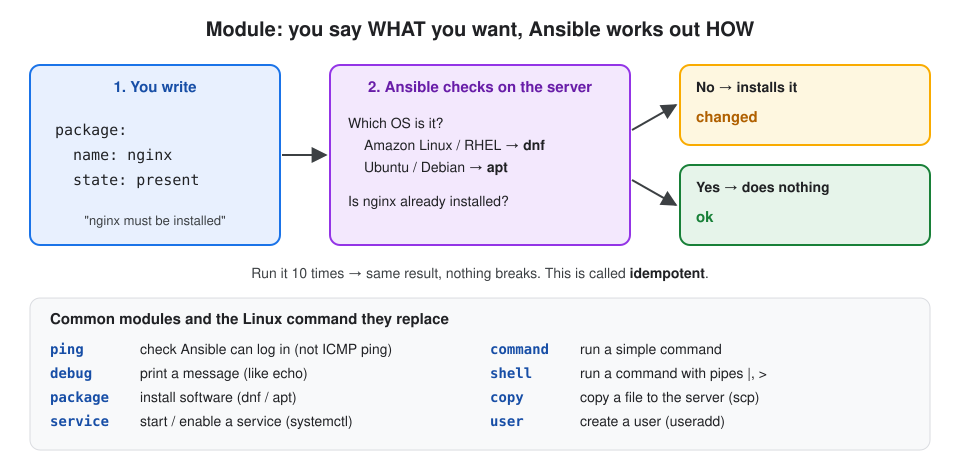
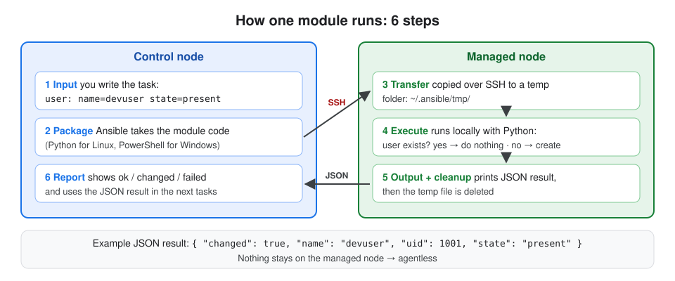

# 3. Modules

## About this topic

Modules are the **tools that do the actual work** in Ansible. Here we learn what they are, how one runs on a server, why they are safe to run twice, and the main types.

| Part | Topic |
|---|---|
| **Part 1: Concepts** | what a module is · idempotency · the JSON result · how a module runs · module types · module names (FQCN) · ad-hoc commands · finding modules |
| **Part 2: Lab** | create, check and delete a user with the `user` module (ad-hoc and playbook) |

[← 2. Inventory](../02-inventory/README.md) · [All topics](../README.md) · Next: [4. YAML & Playbooks →](../04-yaml-and-playbooks/README.md)

## Table of Contents

**Part 1: Concepts**
1. [What is a module?](#1-what-is-a-module)
2. [Idempotency](#2-idempotency)
3. [Every module returns JSON](#3-every-module-returns-json)
4. [How a module runs](#4-how-a-module-runs)
5. [Types of modules](#5-types-of-modules)
6. [Module names (FQCN)](#6-module-names-fqcn)
7. [Ad-hoc commands](#7-ad-hoc-commands)
8. [Finding modules: ansible-doc](#8-finding-modules-ansible-doc)

**Part 2: Lab**
- [Step 1: Create a user (ad-hoc)](#step-1-create-a-user-ad-hoc)
- [Step 2: Run it again (idempotency)](#step-2-run-it-again-idempotency)
- [Step 3: Check the user](#step-3-check-the-user)
- [Step 4: Do the same with a playbook](#step-4-do-the-same-with-a-playbook)
- [Step 5: Delete the user](#step-5-delete-the-user)

[What I learned](#what-i-learned)

---

# Part 1: Concepts

## 1. What is a module?

**Definition:** **Module** = a small, standalone program that does **one job** on a managed node: install a package, create a user, copy a file, start a service.

> If a **playbook** is the instruction manual, **modules** are the **tools** in the toolbox (screwdriver, hammer, wrench) that actually do the work.

Modules are **declarative**: you say the **state** you want, the module does whatever is needed to get there.

| You say (state) | The module does |
|---|---|
| user `devuser` should be `present` | creates it, **only if** it doesn't exist |
| package `nginx` should be `present` | installs it, **only if** it's missing |
| service `nginx` should be `started` | starts it, **only if** it's stopped |
| file should have this content | writes it, **only if** it's different |



## 2. Idempotency

**Definition:** **Idempotent** = running the same module many times gives the same result. It makes a change **only when needed**.

| Example | 1st run | 2nd run |
|---|---|---|
| `user: name=devuser state=present` | user created → `changed` | already exists → `ok` |
| `service: name=nginx state=started` | started → `changed` | already running → `ok` (no restart) |
| `copy: src=index.html dest=/var/www/...` | file written → `changed` | same content → `ok` |
| `apt: name=git state=present` | installed → `changed` | already installed → `ok` (`changed=false`) |

**Why it matters:** you can run a playbook any time, on any server, and only what's wrong gets fixed. Nothing is duplicated and nothing breaks.

> ⚠️ `command` and `shell` modules are **not** idempotent by themselves: they run the command every time and always report `changed`. Prefer a real module (`user`, `package`, `copy`) when one exists.

## 3. Every module returns JSON

**Definition:** after it runs, every module prints a **JSON result**: did it work, did it change anything, plus extra details.

```json
{
  "changed": true,
  "name": "devuser",
  "uid": 1001,
  "home": "/home/devuser",
  "state": "present"
}
```

| Key | Means |
|---|---|
| `changed` | `true` = something was changed, `false` = already correct |
| `failed` | `true` if the module failed |
| `msg` | a message, usually on errors |
| other keys | details from that module (uid, home, path ...) |

Ansible shows this as `ok` / `changed` / `failed`, and you can save it (`register`) to use in later tasks.

## 4. How a module runs

**Definition:** running a module is a short conversation between the control node and the managed node, in **6 steps**.



| # | Step | Where | What happens |
|---|---|---|---|
| 1 | **Input** | control node | you write the module + arguments (playbook or ad-hoc) |
| 2 | **Package** | control node | Ansible takes the module code (Python for Linux, PowerShell for Windows) |
| 3 | **Transfer** | → managed node | copies it over SSH to a temp folder (`~/.ansible/tmp/`) |
| 4 | **Execute** | managed node | runs it locally; checks the current state, changes only what's needed |
| 5 | **Output + cleanup** | managed node | prints the JSON result, temp file is deleted |
| 6 | **Report** | control node | shows `ok` / `changed` / `failed` |

## 5. Types of modules

**Definition:** modules are grouped by **what they manage**.

| Category | Manages | Common modules |
|---|---|---|
| **System** | users, groups, services, scheduled jobs | `user`, `group`, `service`, `systemd`, `cron` |
| **Packaging** | installing software | `package`, `dnf`, `yum`, `apt`, `pip` |
| **Files** | files, folders, permissions, templates | `copy`, `file`, `template`, `lineinfile`, `unarchive` |
| **Commands** | running raw commands | `command`, `shell`, `script` |
| **Utilities** | printing, checks, facts | `debug`, `ping`, `setup`, `assert` |
| **Cloud** | AWS, Azure, GCP resources | `amazon.aws.ec2_instance`, `amazon.aws.s3_bucket` |
| **Database** | DB users and databases | `community.mysql.mysql_db`, `community.postgresql.postgresql_user` |
| **Network** | routers, switches, firewalls | `cisco.ios.ios_config`, `junipernetworks.junos.junos_command` |

**Most used, compared with Linux:**

| Module | Linux command it replaces |
|---|---|
| `package` / `dnf` / `apt` | `dnf install` / `apt install` |
| `service` | `systemctl start / enable` |
| `user` | `useradd` / `userdel` |
| `copy` | `scp` / `cp` |
| `file` | `mkdir`, `chmod`, `chown`, `rm` |
| `command` / `shell` | any command (`shell` allows pipes `\|` and `>`) |
| `debug` | `echo` |

## 6. Module names (FQCN)

**Definition:** **FQCN** (Fully Qualified Collection Name) = the full name of a module: `collection.name`.

| Short name | Full name (FQCN) | Collection |
|---|---|---|
| `copy` | `ansible.builtin.copy` | built-in (comes with Ansible) |
| `user` | `ansible.builtin.user` | built-in |
| `ec2_instance` | `amazon.aws.ec2_instance` | `amazon.aws` (install separately) |

Both `copy:` and `ansible.builtin.copy:` work for built-in modules. The full name is clearer and avoids clashes, so it's the best practice in real projects.

## 7. Ad-hoc commands

**Definition:** **Ad-hoc command** = run **one module** directly from the command line, without writing a playbook. Good for quick checks and one-off jobs.

```
ansible  <hosts>  -i <inventory>  -m <module>  -a "<arguments>"  [-b]
```

| Part | Means |
|---|---|
| `<hosts>` | a group, a host, or `all` |
| `-m` | which module |
| `-a` | the module's arguments, as `key=value` |
| `-b` | **become** root (sudo), needed for users, packages, services |

| Ad-hoc command | Does |
|---|---|
| `ansible all -m ping` | can Ansible log in? |
| `ansible all -m command -a "uptime"` | run a command |
| `ansible web -b -m package -a "name=nginx state=present"` | install nginx |
| `ansible web -b -m service -a "name=nginx state=started"` | start nginx |

> Ad-hoc = quick, one time. **Playbook** = saved, repeatable, many steps.

## 8. Finding modules: ansible-doc

**Definition:** **`ansible-doc`** = shows the documentation of any module, offline: options, defaults and examples.

| Command | Shows |
|---|---|
| `ansible-doc -l` | list of all installed modules |
| `ansible-doc user` | full docs for the `user` module |
| `ansible-doc -s user` | short version: just the options |

---

# Part 2: Lab

> Runs on your control node, on `localhost`. Creating users needs root, so we add `-b` (become).

### Step 1: Create a user (ad-hoc)

```bash
ansible localhost -b -m user -a "name=devuser state=present"
```

**What it does:** the `user` module makes sure a user called `devuser` exists. `-b` runs it with sudo.
**Expected** (yellow):

```
localhost | CHANGED => {
    "changed": true,
    "name": "devuser",
    "home": "/home/devuser",
    "state": "present",
    "uid": 1001
}
```

### Step 2: Run it again (idempotency)

```bash
ansible localhost -b -m user -a "name=devuser state=present"
```

**What it does:** exactly the same command.
**Expected** (green): `localhost | SUCCESS => { "changed": false, ... }`

The user already exists, so the module did **nothing**. That's idempotency.

### Step 3: Check the user

```bash
id devuser
```

**What it does:** the normal Linux command to show a user.
**Expected:** `uid=1001(devuser) gid=1001(devuser) groups=1001(devuser)`

### Step 4: Do the same with a playbook

```bash
mkdir -p ~/ansible-notes-lab/modules-lab
```

```bash
cd ~/ansible-notes-lab/modules-lab
```

```bash
vim create_user.yaml
```

Press `i` and type:

```yaml
- name: Create a new user
  hosts: localhost
  connection: local
  become: yes
  tasks:
  - name: Add a user called devuser2
    ansible.builtin.user:
      name: devuser2
      shell: /bin/bash
      state: present
```

Save and quit: `Esc` → `:wq` → `Enter`.

| Line | Means |
|---|---|
| `hosts: localhost` + `connection: local` | run on this machine, no SSH |
| `become: yes` | run as root (same as `-b`) |
| `ansible.builtin.user:` | the `user` module, full name |
| `shell: /bin/bash` | the user's login shell |

```bash
ansible-playbook create_user.yaml
```

**Expected:** `TASK [Add a user called devuser2]` → `changed: [localhost]`, recap `changed=1`.

```bash
ansible-playbook create_user.yaml
```

**Expected:** this time `ok: [localhost]`, recap `changed=0`.

### Step 5: Delete the user

```bash
ansible localhost -b -m user -a "name=devuser state=absent remove=yes"
```

**What it does:** `state=absent` = the user must **not** exist, so it's deleted. `remove=yes` also deletes its home folder.
**Expected:** `CHANGED`. Run it again → `SUCCESS` (already gone).

```bash
ansible localhost -b -m user -a "name=devuser2 state=absent remove=yes"
```

**What it does:** cleans up the second user.

---

## What I learned

- A **module** = one tool for one job. Playbooks are the manual; modules do the work.
- Modules are **declarative** and **idempotent**: say the state (`present`, `started`, `absent`), and they change only what's needed.
- Every module returns **JSON** (`changed`, `failed`, details) → shown as `ok` / `changed` / `failed`.
- How one runs: input → package → copy over SSH → execute → JSON + cleanup → report.
- Types: system, packaging, files, commands, utilities, cloud, database, network.
- `command` / `shell` always say `changed`; use a real module when one exists.
- **Ad-hoc**: `ansible <hosts> -m <module> -a "<args>" -b`. Docs: `ansible-doc <module>`.

[← 2. Inventory](../02-inventory/README.md) · [All topics](../README.md) · Next: [4. YAML & Playbooks →](../04-yaml-and-playbooks/README.md)
