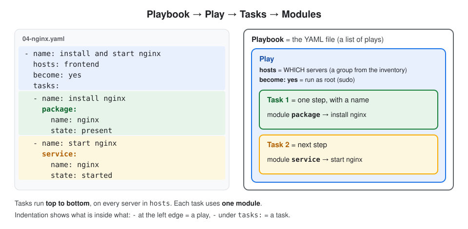
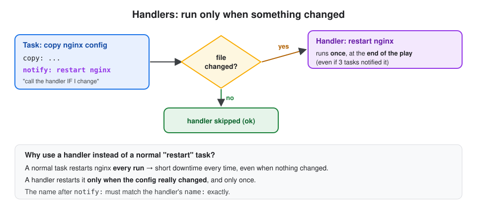

# 4. YAML & Playbooks

## About this topic

Playbooks are where real Ansible work lives: saved, repeatable lists of tasks. They are written in **YAML**, so we learn YAML first, then playbooks, handlers, roles and best practices.

| Part | Topic |
|---|---|
| **Part 1: Concepts** | YAML basics · YAML rules · what a playbook is · playbook structure · keywords · multiple plays · handlers · roles · best practices · useful commands |
| **Part 2: Lab** | install nginx, put a custom web page, and restart nginx with a handler |

[← 3. Modules](../03-modules/README.md) · [All topics](../README.md) · Next: [5. Variables →](../05-variables/README.md)

## Table of Contents

**Part 1: Concepts**
1. [YAML basics](#1-yaml-basics)
2. [YAML rules](#2-yaml-rules)
3. [What is a playbook?](#3-what-is-a-playbook)
4. [Playbook structure](#4-playbook-structure)
5. [Playbook keywords](#5-playbook-keywords)
6. [Many plays in one playbook](#6-many-plays-in-one-playbook)
7. [Handlers](#7-handlers)
8. [Roles](#8-roles)
9. [Best practices](#9-best-practices)
10. [Useful playbook commands](#10-useful-playbook-commands)

**Part 2: Lab**
- [Step 1: Create the project folder](#step-1-create-the-project-folder)
- [Step 2: Write the playbook](#step-2-write-the-playbook)
- [Step 3: Check the syntax](#step-3-check-the-syntax)
- [Step 4: Run the playbook](#step-4-run-the-playbook)
- [Step 5: Check nginx](#step-5-check-nginx)
- [Step 6: Run it again](#step-6-run-it-again)

[What I learned](#what-i-learned)

---

# Part 1: Concepts

## 1. YAML basics

**Definition:** **YAML** = a simple, human-readable text format for data. It uses **`key: value`** pairs, **indentation (spaces)** to show what's inside what, and **`-`** to start a list item. (Name: "YAML Ain't Markup Language".)

**Only 2 shapes to know:**

| Shape | Meaning | YAML | JSON (same data) |
|---|---|---|---|
| **Map** (dictionary) | named fields | `os: Linux`<br>`cm: ansible` | `{"os": "Linux", "cm": "ansible"}` |
| **List** | items in order | `- Linux`<br>`- Ansible` | `["Linux", "Ansible"]` |

**Example: a student**

```yaml
first_name: Sivakumar          # map: key: value
last_name: M
addresses:                     # a list of 2 maps (each starts with -)
  - type: permanent
    city: Hyderabad
  - type: temporary
    city: Hyderabad
skills:                        # a map inside a map
  os: Linux
  cm: ansible
```

**Same data in JSON and XML:**

| | XML | JSON | YAML |
|---|---|---|---|
| Looks like | `<city>Hyderabad</city>` | `{"city": "Hyderabad"}` | `city: Hyderabad` |
| Comments | `<!-- -->` | ❌ none | `#` |
| Length | longest | medium | **shortest** |
| Used in | Maven `pom.xml` | APIs, AWS CLI output | **Ansible**, Kubernetes, GitHub Actions |

## 2. YAML rules

| Rule | ✅ Right | ❌ Wrong |
|---|---|---|
| space after `:` | `name: nginx` | `name:nginx` |
| indent with **spaces**, never tabs | 2 spaces | a Tab |
| same level = same indentation | `name:` and `state:` in the same column | one of them shifted |
| `-` + space starts a list item | `- name: install` | `-name: install` |
| no commas at line ends | `city: Hyderabad` | `city: Hyderabad,` |
| quote values that start with `{{` | `msg: "{{ name }}"` | `msg: {{ name }}` |
| `#` = comment | `# install nginx` | |

> **Tip:** check a file before running it with `ansible-playbook file.yaml --syntax-check`, or paste it into an online YAML checker.

## 3. What is a playbook?

**Definition:** **Playbook** = a YAML file with an **ordered list of tasks** to run on a set of hosts. It's saved, so you can run the same steps again and again, on any number of servers.

| Ad-hoc command | Playbook |
|---|---|
| one module, typed once | many tasks, saved in a file |
| quick checks | real setups: install, configure, deploy |
| not kept | kept in Git, shared, reviewed |

> Full comparison with diagram: [Module vs ad-hoc command vs playbook](../03-modules/README.md#9-module-vs-ad-hoc-command-vs-playbook).

## 4. Playbook structure

**Definition:** a playbook has **plays**, a play has **tasks**, and each task runs **one module**.



| Word | Meaning |
|---|---|
| **Playbook** | the `.yaml` file (a list of plays) |
| **Play** | which hosts (`hosts:`) + the list of `tasks:` for them |
| **Task** | one step, with a `name`, running one module |
| **Module** | what the task actually does |
| **Handler** | a task that runs only when notified by a change |
| **Role** | a reusable folder of tasks, handlers, variables and files |

### Play vs task: reading `- name:`

In YAML, `-` starts **a new item in a list**. `name:` is just a **label** (a description shown in the output). So `- name:` means "a new item, and here's its label". **Where** it sits decides whether that item is a **play** or a **task**:

```yaml
- name: create ec2 instances and r53 records   ← PLAY  (left edge, no indent)
  hosts: local
  connection: local
  tasks:
  - name: create ec2 instance                  ← TASK  (under tasks:)
    amazon.aws.ec2_instance:
      name: "roboshop-{{ item }}"              ← module option, NOT a task name
  - name: create R53 record                    ← TASK  (under tasks:)
    amazon.aws.route53:
      zone: example.com
```

| Where `- name:` sits | It names a… |
|---|---|
| At the **left edge** of the file | **Play** (a playbook is a list of plays) |
| Under **`tasks:`** | **Task** (a play has a list of tasks) |

**Simple rule:** top level = play, under `tasks:` = task.

The label shows up when the playbook runs:

```
PLAY [create ec2 instances and r53 records] *************
TASK [create ec2 instance] ******************************
TASK [create R53 record] ********************************
```

| Point | Detail |
|---|---|
| Is `name` required? | No, the task still runs without it. But always write one: the output and errors become easy to read |
| Who does the work? | The **module** line (`amazon.aws.ec2_instance:`), not `name` |
| Two different `name`s | `- name:` (with a dash, task level) = description. `name:` **under a module** (one level deeper) = a real option, here the EC2 instance's Name tag in AWS |

### Example: a real playbook, line by line

This playbook sets up a MongoDB server (RoboShop's database). Every line has a `#` comment saying what it does. Ansible ignores everything after `#`.

```yaml
- name: configure mongodb server        # PLAY: its label, shown as PLAY [...] in the output
  hosts: mongodb                        # run on the hosts in the "mongodb" group of the inventory
  become: yes                           # run tasks as root (sudo), needed to install and edit system files
  tasks:                                # the list of steps, run top to bottom
  - name: copy mongo repo               # TASK 1: its label
    copy:                               # module: copy a file from the control node to the server
      src: mongo.repo                   # file next to the playbook (on the control node)
      dest: /etc/yum.repos.d/mongo.repo # where it goes on the server, so dnf knows where to download MongoDB

  - name: install mongodb server        # TASK 2
    package:                            # module: install a package (uses dnf/yum/apt automatically)
      name: mongodb-org                 # package name (from the repo added in task 1)
      state: present                    # install it if missing; do nothing if already installed

  - name: start and enable mongodb      # TASK 3
    service:                            # module: manage a systemd service
      name: mongod                      # the service name (package is mongodb-org, service is mongod)
      state: started                    # start it now if it isn't running
      enabled: yes                      # also start it automatically after every reboot

  - name: allow remote connections      # TASK 4
    replace:                            # module: find and replace text inside a file
      path: /etc/mongod.conf            # MongoDB's config file
      regexp: '127.0.0.1'               # find: listen only on localhost (no remote access)
      replace: '0.0.0.0'                # replace with: listen on all IPs, so catalogue/user servers can connect

  - name: restart mongod                # TASK 5
    service:                            # same module as task 3
      name: mongod
      state: restarted                  # restart, so the new config (0.0.0.0) is loaded
```

| Task | Module | Why this step |
|---|---|---|
| 1. copy mongo repo | `copy` | MongoDB isn't in the default OS repos, so we add its repo first |
| 2. install | `package` | Installs `mongodb-org` from that repo |
| 3. start and enable | `service` | Runs now **and** after reboots |
| 4. allow remote connections | `replace` | By default MongoDB listens only on `127.0.0.1`; other servers need `0.0.0.0` |
| 5. restart | `service` | A config change only takes effect after a restart |

> **Better way:** task 5 restarts MongoDB on **every** run, even when nothing changed. A **handler** restarts it only when task 4 actually changes the file: see [Handlers](#7-handlers).

## 5. Playbook keywords

```yaml
---
- name: Setup nginx web server
  hosts: webservers
  become: true
  gather_facts: true
  vars:
    page_title: Welcome to Ansible
  tasks:
  - name: Install nginx
    ansible.builtin.package:
      name: nginx
      state: present
  handlers:
  - name: restart nginx
    ansible.builtin.service:
      name: nginx
      state: restarted
```

| Keyword | Means |
|---|---|
| `---` | optional "start of YAML document" line |
| `name:` | a label shown in the output (always write one) |
| `hosts:` | which group/hosts from the inventory |
| `become: true` | run tasks as **root** (sudo) |
| `gather_facts:` | collect OS/IP info first (`true` by default) |
| `vars:` | variables for this play |
| `tasks:` | the steps, run **top to bottom** |
| `handlers:` | tasks that run only when notified |
| `connection: local` | run on the control node itself, no SSH |

## 6. Many plays in one playbook

**Definition:** a playbook can have **more than one play**. Plays run **top to bottom**, and each can target **different hosts**.

```yaml
- name: Set up database
  hosts: databases
  tasks:
  - name: ...

- name: Set up web servers
  hosts: webservers
  tasks:
  - name: ...
```

One command sets up the database **first**, then the web servers: this is **orchestration**.

> `-` at the **left edge** = a new **play**. `-` under `tasks:` = a new **task**.

## 7. Handlers

**Definition:** **Handler** = a special task that runs **only when another task notifies it**, and only if that task **changed** something. Most common use: restart a service after its config changes.



```yaml
  tasks:
  - name: Copy nginx config
    ansible.builtin.copy:
      src: nginx.conf
      dest: /etc/nginx/nginx.conf
    notify: restart nginx

  handlers:
  - name: restart nginx
    ansible.builtin.service:
      name: nginx
      state: restarted
```

| Rule | Detail |
|---|---|
| `notify:` | on the task; the handler's name |
| runs only if | the notifying task reports `changed` |
| runs when | **once**, at the **end of the play** (even if notified many times) |
| name | must match exactly |

## 8. Roles

**Definition:** **Role** = a standard folder structure that groups everything for one job (e.g. "webserver"): tasks, handlers, variables, files and templates. It makes playbooks short and reusable.

```
roles/
└── webserver/
    ├── tasks/main.yaml        ← the tasks
    ├── handlers/main.yaml     ← the handlers
    ├── vars/main.yaml         ← variables
    ├── defaults/main.yaml     ← default values (lowest priority)
    ├── templates/             ← .j2 template files
    └── files/                 ← plain files to copy
```

The playbook then becomes just:

```yaml
- name: Configure web servers
  hosts: webservers
  become: true
  roles:
  - webserver
```

> Roles get their own topic later. For now: **roles = playbooks split into a standard folder layout**.

## 9. Best practices

| Practice | Why |
|---|---|
| give every play and task a clear `name` | the output reads like a checklist |
| use real modules, not `shell` | real modules are idempotent and report `changed` correctly |
| use the full module name (`ansible.builtin.copy`) | clear and avoids name clashes |
| use **variables** for values that change (ports, versions, users) | one playbook for dev, test and prod |
| use **handlers** to restart services | restart only when config really changed |
| group bigger setups into **roles** | reusable and easy to read |
| keep playbooks in **Git** | history, review, teamwork |
| never put passwords in plain text | use `vars_prompt` or Ansible Vault |
| run `--syntax-check` and `--check` first | catch mistakes before touching servers |

## 10. Useful playbook commands

| Command | Does |
|---|---|
| `ansible-playbook site.yaml` | run the playbook |
| `ansible-playbook site.yaml --syntax-check` | check the YAML only |
| `ansible-playbook site.yaml --check` | dry run: shows what **would** change, changes nothing |
| `ansible-playbook site.yaml --list-tasks` | list the tasks without running |
| `ansible-playbook site.yaml -v` | more detail (`-vv`, `-vvv` for even more) |
| `ansible-playbook site.yaml --limit web1` | run only on one host |

---

# Part 2: Lab

> Runs on your control node (`localhost`, Amazon Linux 2023). We install nginx, add our own web page, and use a **handler** to restart nginx only when its config changes.

### Step 1: Create the project folder

```bash
mkdir -p ~/ansible-notes-lab/playbook-lab
```

```bash
cd ~/ansible-notes-lab/playbook-lab
```

### Step 2: Write the playbook

```bash
vim nginx.yaml
```

Press `i` and type:

```yaml
---
- name: Setup nginx web server
  hosts: localhost
  connection: local
  become: true
  tasks:
  - name: Install nginx
    ansible.builtin.package:
      name: nginx
      state: present

  - name: Create a custom index.html
    ansible.builtin.copy:
      dest: /usr/share/nginx/html/index.html
      content: "<h1>Welcome to Ansible Automation!</h1>\n"

  - name: Hide the nginx version
    ansible.builtin.copy:
      dest: /etc/nginx/conf.d/security.conf
      content: "server_tokens off;\n"
    notify: restart nginx

  - name: Start and enable nginx
    ansible.builtin.service:
      name: nginx
      state: started
      enabled: yes

  handlers:
  - name: restart nginx
    ansible.builtin.service:
      name: nginx
      state: restarted
```

Save and quit: `Esc` → `:wq` → `Enter`.

| Task | Module | Does |
|---|---|---|
| Install nginx | `package` | installs nginx (`dnf` here) |
| Create a custom index.html | `copy` + `content` | writes our web page |
| Hide the nginx version | `copy` + `notify` | adds a config line; **notifies** the handler if the file changed |
| Start and enable nginx | `service` | running now + on every boot |
| handler: restart nginx | `service` | restarts nginx to load the new config, only when notified |

### Step 3: Check the syntax

```bash
ansible-playbook nginx.yaml --syntax-check
```

**What it does:** checks the YAML and keywords without running anything.
**Expected:** `playbook: nginx.yaml`. Anything else points to the line with the mistake.

### Step 4: Run the playbook

```bash
ansible-playbook nginx.yaml
```

**Expected** (short):

```
TASK [Install nginx]                  changed: [localhost]
TASK [Create a custom index.html]     changed: [localhost]
TASK [Hide the nginx version]         changed: [localhost]
TASK [Start and enable nginx]         changed: [localhost]
RUNNING HANDLER [restart nginx]       changed: [localhost]

PLAY RECAP
localhost : ok=6  changed=5  unreachable=0  failed=0
```

The handler ran **at the end**, because "Hide the nginx version" changed.

### Step 5: Check nginx

```bash
curl http://localhost
```

**Expected:** `<h1>Welcome to Ansible Automation!</h1>`

```bash
curl -I http://localhost
```

**Expected:** `HTTP/1.1 200 OK` and `Server: nginx` (with **no version number**, thanks to `server_tokens off`).

### Step 6: Run it again

```bash
ansible-playbook nginx.yaml
```

**Expected:** every task `ok`, **no** `RUNNING HANDLER` line, recap `changed=0`.

Nothing changed, so nothing was done and nginx was **not** restarted: idempotency + handlers working together.

**Clean up** (optional):

```bash
sudo dnf remove nginx -y
```

---

## What I learned

- **YAML**: `key: value` = map, `-` = list item, spaces (never tabs) show nesting.
- **Playbook** → plays (`hosts`) → tasks (`name`) → modules. Tasks run top to bottom.
- Keywords: `name`, `hosts`, `become`, `gather_facts`, `vars`, `tasks`, `handlers`.
- Many plays in one file = orchestration in the right order.
- **Handlers** run once, at the end, only if a notifying task **changed**.
- **Roles** = a standard folder layout for reusable tasks, handlers, vars and files.
- Before running: `--syntax-check` and `--check`.

[← 3. Modules](../03-modules/README.md) · [All topics](../README.md) · Next: [5. Variables →](../05-variables/README.md)
