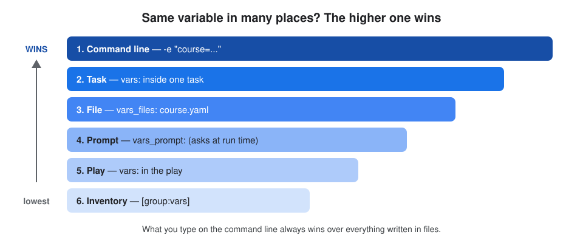

# 5. Variables

## About this topic

Variables make one playbook work for many servers and environments. Here we learn how to define them, where they can live, their types, the special built-in ones, and which value wins when the same name is defined twice.

| Part | Topic |
|---|---|
| **Part 1: Concepts** | what a variable is · naming rules · where to define variables · types · special variables · facts · `register` · precedence |
| **Part 2: Lab** | define variables in the inventory, `group_vars`, `host_vars`, a vars file and `-e`, then see which wins |

[← 4. YAML & Playbooks](../04-yaml-and-playbooks/README.md) · [All topics](../README.md)

## Table of Contents

**Part 1: Concepts**
1. [What is a variable?](#1-what-is-a-variable)
2. [Naming rules](#2-naming-rules)
3. [Where to define variables](#3-where-to-define-variables)
4. [Types of variables](#4-types-of-variables)
5. [Special variables](#5-special-variables)
6. [Facts](#6-facts)
7. [Saving a task's result: register](#7-saving-a-tasks-result-register)
8. [Precedence: which value wins?](#8-precedence-which-value-wins)

**Part 2: Lab**
- [Step 1: Create the project folder](#step-1-create-the-project-folder)
- [Step 2: Inventory](#step-2-inventory)
- [Step 3: group_vars and host_vars](#step-3-group_vars-and-host_vars)
- [Step 4: A vars file](#step-4-a-vars-file)
- [Step 5: The playbook](#step-5-the-playbook)
- [Step 6: Run it](#step-6-run-it)
- [Step 7: Override with -e](#step-7-override-with--e)

[What I learned](#what-i-learned)

---

# Part 1: Concepts

## 1. What is a variable?

**Definition:** **Variable** = a **name that stores a value** (text, number, list, dictionary). You write the value once and use it anywhere with **`{{ name }}`**, instead of hardcoding it.

```yaml
- name: Create a user using variables
  hosts: all
  become: true
  vars:
    user_name: devuser
    user_shell: /bin/bash
  tasks:
  - name: Add the user
    ansible.builtin.user:
      name: "{{ user_name }}"
      shell: "{{ user_shell }}"
      state: present
```

| Part | Means |
|---|---|
| `vars:` | define the variables (a map: `name: value`) |
| `"{{ user_name }}"` | use the value; Ansible replaces it with `devuser` when it runs |
| quotes `" "` | needed when a value **starts** with `{{` |

**Why use variables?** To create another user, change only `user_name`. The same playbook works for dev, test and prod, and for servers that differ (ports, package names, users).

| Shell | Ansible |
|---|---|
| `USER_NAME="devuser"` | `user_name: devuser` |
| `echo "$USER_NAME"` | `msg: "{{ user_name }}"` |

## 2. Naming rules

| Rule | ✅ Valid | ❌ Invalid |
|---|---|---|
| letters, numbers and `_` only | `app_port` | `app-port` (hyphen), `app port` (space), `backup@time` |
| start with a letter or `_` | `user1`, `_tmp` | `1st_user` |
| don't use reserved words | `app_hosts` | `hosts`, `name`, `lambda`, `class` |
| use **lowercase + `_`** (convention) | `max_clients` | `MaxClients` (works, but not the style) |

## 3. Where to define variables

**Definition:** variables can be defined in many places. Pick the place by **who the value belongs to**: one play, one host, a group, or one run.

| # | Where | How | Best for |
|---|---|---|---|
| 1 | **Play** | `vars:` in the play | values only this playbook uses |
| 2 | **Task** | `vars:` under one task | a value for one task only |
| 3 | **Vars file** | `vars_files: [vars/common.yaml]` | many variables, shared by playbooks; keeps data out of code |
| 4 | **Prompt** | `vars_prompt:` | values typed at run time (passwords) |
| 5 | **Inventory** | `web1 app_port=8080` / `[web:vars]` | per-host or per-group values |
| 6 | **group_vars / host_vars folders** | `group_vars/webservers.yaml`, `host_vars/web1.yaml` | the clean, real-project way to do #5 |
| 7 | **Command line** | `-e "app_port=9090"` | one-off overrides, CI pipelines |
| 8 | **set_fact** | `ansible.builtin.set_fact:` in a task | values calculated while the playbook runs |
| 9 | **register** | `register: result` on a task | saving a task's output |
| 10 | **Facts** | collected automatically | OS, IP, memory of each host |

**group_vars and host_vars folders** (next to the inventory or playbook):

```
project/
├── inventory.ini
├── site.yaml
├── group_vars/
│   ├── all.yaml            ← every host
│   └── webservers.yaml     ← every host in [webservers]
└── host_vars/
    └── web1.yaml           ← only web1
```

Ansible loads them **automatically**: the file name must match the group or host name.

**set_fact example:**

```yaml
  - name: Set application status
    ansible.builtin.set_fact:
      app_status: running

  - name: Show it
    ansible.builtin.debug:
      msg: "Application status: {{ app_status }}"
```

## 4. Types of variables

**Definition:** a variable can hold a **simple value** or **structured data**.

**Simple** (one value):

```yaml
app_name: SimpleApp       # string (text)
max_retries: 5            # number
debug_mode: true          # boolean (true / false)
```

**List** (many values in order):

```yaml
packages:
  - nginx
  - git
  - vim
```

Use: `{{ packages[0] }}` → `nginx` (counting starts at 0).

**Dictionary / map** (named fields):

```yaml
database:
  host: db.example.com
  port: 5432
  user: db_user
```

Use: `{{ database.host }}` or `{{ database['port'] }}`.

**Nested** (a list of maps):

```yaml
servers:
  - name: web1
    ip: 192.168.1.10
  - name: web2
    ip: 192.168.1.11
```

| Expression | Value |
|---|---|
| `{{ servers[0].name }}` | `web1` |
| `{{ servers[1].ip }}` | `192.168.1.11` |

## 5. Special variables

**Definition:** **special variables** are created by Ansible itself. You don't define them; you just use them.

| Type | Example | Gives |
|---|---|---|
| **Magic variables** (about the run) | `inventory_hostname` | this host's name in the inventory |
| | `groups['webservers']` | list of hosts in a group |
| | `hostvars['web1']` | all variables of another host |
| **Connection variables** (how to log in) | `ansible_host`, `ansible_user`, `ansible_port` | the IP, user, port used |
| | `ansible_connection` | `ssh` or `local` |
| **Facts** (about the server) | `ansible_facts['distribution']` | e.g. `Amazon` |

```yaml
  - name: Show inventory hostname
    ansible.builtin.debug:
      msg: "This is running on {{ inventory_hostname }}"
```

**Expected:** `This is running on web1`

## 6. Facts

**Definition:** **Facts** = information Ansible **collects automatically** about each host at the start of a play ("Gathering Facts"): OS, IP, CPU, memory, hostname. Stored in `ansible_facts`.

| Fact | Example value |
|---|---|
| `ansible_facts['nodename']` | `ip-172-31-5-204` |
| `ansible_facts['distribution']` | `Amazon` |
| `ansible_facts['distribution_version']` | `2023` |
| `ansible_facts['os_family']` | `RedHat` |
| `ansible_facts['default_ipv4']['address']` | `172.31.5.204` |
| `ansible_facts['memtotal_mb']` | `916` |

```yaml
  - name: Show system info
    ansible.builtin.debug:
      msg: "Host {{ ansible_facts['nodename'] }} runs {{ ansible_facts['distribution'] }}"
```

See every fact for a host: `ansible localhost -m setup`. Turn facts off (faster) with `gather_facts: false` when you don't need them.

## 7. Saving a task's result: register

**Definition:** **`register`** = save the JSON result of a task into a variable, to use in later tasks.

```yaml
  - name: Check uptime
    ansible.builtin.command: uptime
    register: up

  - name: Print it
    ansible.builtin.debug:
      msg: "{{ up.stdout }}"
```

| Key | Means |
|---|---|
| `up.stdout` | the command's output |
| `up.rc` | return code (`0` = success) |
| `up.changed` | did the task change anything |

## 8. Precedence: which value wins?

**Definition:** **Variable precedence** = when the **same variable name** is defined in several places, Ansible uses the one with the **highest priority**.

**Simplified order (1 = wins):**

| # | Where | Note |
|---|---|---|
| 1 | **Extra vars** `-e` | always wins |
| 2 | `set_fact` / `register` | set while running |
| 3 | **Task** `vars:` | only that task |
| 4 | **Block** `vars:` | tasks in that block |
| 5 | **Role** `vars/main.yaml` | |
| 6 | `vars_files:` | |
| 7 | `vars_prompt:` | |
| 8 | **Play** `vars:` | |
| 9 | Facts | |
| 10 | **Host** variables (inventory, `host_vars/`) | host beats group |
| 11 | **Group** variables (inventory, `group_vars/`) | a child group beats `all` |
| 12 | **Role defaults** `defaults/main.yaml` | lowest, meant to be overridden |

The 6 most used, as a picture:



**Easy way to remember:**
- **more specific wins:** task beats play, host beats group, a group beats `all`
- **later and runtime wins:** `-e` on the command line beats everything in files
- **role defaults** are the weakest: they're "suggestions" to be overridden

> If the same variable is defined twice **at the same level**, the **last one loaded** wins.

---

# Part 2: Lab

> One project with `web1` and `web2` (both run on localhost with `ansible_connection=local`). We define `app_port` and `app_name` in several places and watch which value wins.

### Step 1: Create the project folder

```bash
mkdir -p ~/ansible-notes-lab/variables-lab/group_vars
```

```bash
mkdir -p ~/ansible-notes-lab/variables-lab/host_vars
```

```bash
mkdir -p ~/ansible-notes-lab/variables-lab/vars
```

```bash
cd ~/ansible-notes-lab/variables-lab
```

### Step 2: Inventory

```bash
vim inventory.ini
```

Press `i`, type, then `Esc` → `:wq`:

```ini
[webservers]
web1
web2

[all:vars]
ansible_connection=local
```

### Step 3: group_vars and host_vars

```bash
vim group_vars/webservers.yaml
```

```yaml
app_port: 8080
app_env: production
```

(For every file in this lab: press `i`, type, then `Esc` → `:wq`.)

**What it does:** every host in `[webservers]` gets `app_port: 8080` and `app_env: production`.

```bash
vim host_vars/web1.yaml
```

```yaml
app_port: 9000
```

**What it does:** only `web1` gets `app_port: 9000`. Host beats group, so web1 = 9000, web2 = 8080.

### Step 4: A vars file

```bash
vim vars/common.yaml
```

```yaml
app_name: MyApp
```

### Step 5: The playbook

```bash
vim site.yaml
```

```yaml
- name: Deploy application
  hosts: webservers
  gather_facts: false
  vars_files:
  - vars/common.yaml
  tasks:
  - name: Display application information
    ansible.builtin.debug:
      msg: "{{ inventory_hostname }}: deploying {{ app_name }} ({{ app_env }}) on port {{ app_port }}"
```

| Variable | Comes from |
|---|---|
| `inventory_hostname` | Ansible (magic variable) |
| `app_name` | `vars/common.yaml` |
| `app_env` | `group_vars/webservers.yaml` |
| `app_port` | `host_vars/web1.yaml` for web1, `group_vars/webservers.yaml` for web2 |

Your folder now looks like this:

```
variables-lab/
├── inventory.ini
├── site.yaml
├── group_vars/
│   └── webservers.yaml
├── host_vars/
│   └── web1.yaml
└── vars/
    └── common.yaml
```

### Step 6: Run it

```bash
ansible-playbook -i inventory.ini site.yaml
```

**Expected:**

```
ok: [web1] => { "msg": "web1: deploying MyApp (production) on port 9000" }
ok: [web2] => { "msg": "web2: deploying MyApp (production) on port 8080" }
```

web1 got **9000** (host_vars beat group_vars); web2 got **8080** (only group_vars).

### Step 7: Override with -e

```bash
ansible-playbook -i inventory.ini site.yaml -e "app_port=7000"
```

**What it does:** passes `app_port` on the command line (extra vars).
**Expected:** both web1 and web2 now say **port 7000**: `-e` beats host_vars and group_vars.

```bash
ansible-playbook -i inventory.ini site.yaml -e "app_name='My Shop App'"
```

**What it does:** a value **with spaces** needs inner quotes `'...'`.
**Expected:** `deploying My Shop App (production) ...`. Without the inner quotes you'd get only `My`.

---

## What I learned

- A **variable** stores a value; use it with `"{{ name }}"` (quote it when it starts the value).
- Names: lowercase letters, numbers, `_`; start with a letter; no `-`, spaces or reserved words.
- Define in: play, task, `vars_files`, `vars_prompt`, inventory, **`group_vars/` and `host_vars/`**, `-e`, `set_fact`, `register`, facts.
- Types: simple (string, number, boolean), **list** (`[0]`), **dictionary** (`.key`), nested.
- Special: magic (`inventory_hostname`, `groups`, `hostvars`), connection (`ansible_user`...), **facts** (`ansible_facts[...]`).
- **Precedence:** `-e` wins → set_fact → task → block → role vars → vars_files → prompt → play → facts → host vars → group vars → role defaults. More specific wins.

[← 4. YAML & Playbooks](../04-yaml-and-playbooks/README.md) · [All topics](../README.md)
