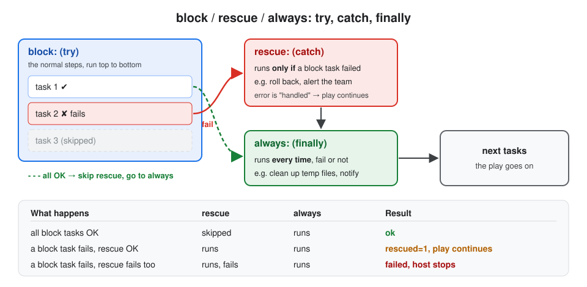

# 6. Error Handling

## About this topic

Things go wrong: a package repo is down, a file is missing, a service won't start. **Error handling** decides what Ansible does next: stop, keep going, retry, or run recovery steps.

| Part | Topic |
|---|---|
| **Part 1: Concepts** | default behaviour · key terms · common errors · `ignore_errors` · `register` + `when` · `failed_when` / `changed_when` · `fail` and `assert` · `block` / `rescue` / `always` · retries · stopping the whole play · handlers and failures · best practices |
| **Part 2: Lab** | 4 small playbooks: ignore an error, custom failure rules, roll back with rescue, retry until ready |

[← 5. Variables](../05-variables/README.md) · [All topics](../README.md)

## Table of Contents

**Part 1: Concepts**
1. [What happens when a task fails?](#1-what-happens-when-a-task-fails)
2. [Key terms](#2-key-terms)
3. [Common types of errors](#3-common-types-of-errors)
4. [ignore_errors: keep going](#4-ignore_errors-keep-going)
5. [register + when: decide based on the result](#5-register--when-decide-based-on-the-result)
6. [failed_when and changed_when: your own rules](#6-failed_when-and-changed_when-your-own-rules)
7. [fail and assert: stop on purpose](#7-fail-and-assert-stop-on-purpose)
8. [block, rescue, always: try / catch / finally](#8-block-rescue-always-try--catch--finally)
9. [until, retries, delay: try again](#9-until-retries-delay-try-again)
10. [Stopping the whole play](#10-stopping-the-whole-play)
11. [Handlers and failures](#11-handlers-and-failures)
12. [Best practices](#12-best-practices)

**Part 2: Lab**
- [Step 1: Create the project folder](#step-1-create-the-project-folder)
- [Step 2: ignore_errors + register](#step-2-ignore_errors--register)
- [Step 3: failed_when, changed_when, fail](#step-3-failed_when-changed_when-fail)
- [Step 4: block, rescue, always](#step-4-block-rescue-always)
- [Step 5: retries until ready](#step-5-retries-until-ready)

[What I learned](#what-i-learned)

---

# Part 1: Concepts

## 1. What happens when a task fails?

**Definition:** **Error handling** = telling Ansible what to do when a task fails, instead of just stopping.

**Default behaviour (no error handling):**

```
host1:  task 1 ✔ → task 2 ✘ FAILED → STOP (no more tasks on host1)
host2:  task 1 ✔ → task 2 ✔ → task 3 ✔ ...   (other hosts carry on)
```

| Rule | Meaning |
|---|---|
| a task fails on a host | that host **stops**; the remaining tasks are skipped for it |
| other hosts | **continue** normally |
| at the end | PLAY RECAP shows `failed=1` for that host |

With error handling you can change this: **ignore** the error, **define** what counts as failure, **recover** with rescue, **retry**, or **stop everything** at once.

## 2. Key terms

| Term | One-line definition |
|---|---|
| **`ignore_errors`** | if this task fails, mark it "ignored" and continue |
| **`register`** | save a task's result in a variable to check later |
| **`failed_when`** | your own rule for when a task counts as **failed** |
| **`changed_when`** | your own rule for when a task counts as **changed** |
| **`fail`** module | stop on purpose, with your message |
| **`assert`** module | check that conditions are true; fail with a message if not |
| **`block`** | a group of tasks treated as one unit (try) |
| **`rescue`** | tasks that run only if something in the block failed (catch) |
| **`always`** | tasks that run every time, failed or not (finally) |
| **`until` / `retries` / `delay`** | repeat a task until a condition is true |
| **`any_errors_fatal`** | if one host fails, stop the play on **all** hosts |

## 3. Common types of errors

| Error type | Example message | Usual fix |
|---|---|---|
| **Syntax** | `could not find expected ':'` | fix YAML indentation / spacing; run `--syntax-check` |
| **Connection** | `UNREACHABLE! ... timed out` / `Permission denied (publickey)` | security group port 22, correct IP, user and key |
| **Module** | `Unsupported parameters for (copy) module: nmae` | fix the option name; check `ansible-doc <module>` |
| **Variable** | `'app_port' is undefined` | define the variable, or use `{{ app_port \| default(80) }}` |
| **Permission** | `Permission denied` on a task | add `become: true` |
| **Resource missing** | `No package matching 'xyz' found` | wrong package name for this OS, or the repo isn't enabled |
| **Command failed** | `non-zero return code` (`rc: 1`) | the command itself failed: read `stderr` |

## 4. ignore_errors: keep going

**Definition:** **`ignore_errors: true`** = if this task fails, Ansible shows the error, marks it **"...ignoring"**, and continues with the next task.

```yaml
- name: Remove old log folder (fine if it's not there)
  ansible.builtin.command: rm -r /opt/app/old-logs
  ignore_errors: true
```

| Use it for | Don't use it for |
|---|---|
| non-critical steps (cleanup, optional checks) | important steps: you'd hide a real problem |

> `ignore_unreachable: true` is the same idea for hosts that can't be reached.

## 5. register + when: decide based on the result

**Definition:** **`register`** saves the result; **`when`** runs the next task only if a condition is true. Together they let you react to what happened.

```yaml
- name: Check if the app is installed
  ansible.builtin.command: which myapp
  register: app_check
  ignore_errors: true

- name: Install the app only if missing
  ansible.builtin.package:
    name: myapp
    state: present
  when: app_check.rc != 0
```

| Registered key | Means |
|---|---|
| `result.rc` | return code (`0` = success) |
| `result.stdout` / `result.stderr` | normal output / error output |
| `result.failed` | `true` if the task failed |
| `result.changed` | `true` if it changed something |
| `result is failed` / `result is succeeded` | test style, same idea |

## 6. failed_when and changed_when: your own rules

**Definition:**
- **`failed_when`** = you decide when the task is **failed** (instead of only "return code is not 0").
- **`changed_when`** = you decide when the task is **changed**. Use `changed_when: false` for commands that only read something.

```yaml
- name: Check disk usage of /
  ansible.builtin.shell: df --output=pcent / | tail -1 | tr -dc '0-9'
  register: disk
  changed_when: false                    # only reads, never "changed"
  failed_when: disk.stdout | int > 90    # fail if the disk is over 90% full
```

| Example | Why |
|---|---|
| `failed_when: "'ERROR' in result.stdout"` | the command returns 0 but prints an error |
| `failed_when: result.rc not in [0, 1]` | `grep` returns 1 for "not found", which is OK here |
| `failed_when: false` | never fail (similar to ignore_errors, but no error shown) |
| `changed_when: false` | read-only commands (`cat`, `grep`, `systemctl status`) |

> This also fixes the problem that `command` / `shell` always say `changed`.

## 7. fail and assert: stop on purpose

**Definition:**
- **`fail`** module = stop the host **on purpose** with a clear message (use it with `when`).
- **`assert`** module = check one or more conditions; if any is false, fail with your message.

```yaml
- name: Check the config file exists
  ansible.builtin.stat:
    path: /etc/myapp.conf
  register: conf

- name: Stop if it's missing
  ansible.builtin.fail:
    msg: "/etc/myapp.conf is missing. Create it first."
  when: not conf.stat.exists
```

```yaml
- name: Check we are on a supported OS with enough memory
  ansible.builtin.assert:
    that:
      - ansible_facts['os_family'] == "RedHat"
      - ansible_facts['memtotal_mb'] >= 1024
    fail_msg: "Need a RedHat-family OS with at least 1 GB RAM"
    success_msg: "Server checks passed"
```

Checking requirements **first** gives a clear message instead of a confusing failure halfway through.

## 8. block, rescue, always: try / catch / finally

**Definition:**
- **`block`** = a group of tasks run as one unit (**try**).
- **`rescue`** = runs **only if** a task in the block failed (**catch**). If rescue succeeds, the error counts as **handled** and the play continues.
- **`always`** = runs **every time**, failed or not (**finally**).



```yaml
- name: Deploy the app
  block:
  - name: Download the new version
    ansible.builtin.get_url:
      url: https://example.com/app-v2.tar.gz
      dest: /tmp/app.tar.gz
  - name: Restart the app
    ansible.builtin.service:
      name: myapp
      state: restarted

  rescue:
  - name: Roll back to the old version
    ansible.builtin.debug:
      msg: "'{{ ansible_failed_task.name }}' failed, rolling back"

  always:
  - name: Clean up
    ansible.builtin.file:
      path: /tmp/app.tar.gz
      state: absent
```

| Inside `rescue` you can use | Gives |
|---|---|
| `ansible_failed_task.name` | the name of the task that failed |
| `ansible_failed_result` | the full result of the failed task |

> `block` can also share settings with all its tasks (`become: true`, `when:`), so you don't repeat them.

## 9. until, retries, delay: try again

**Definition:** **`until`** = repeat the task until a condition is true, up to **`retries`** times, waiting **`delay`** seconds between tries. Good for things that need time: a service starting, an API coming up.

```yaml
- name: Wait until the app answers
  ansible.builtin.uri:
    url: http://localhost:8080/health
  register: health
  until: health.status == 200
  retries: 10
  delay: 5
```

| Keyword | Means |
|---|---|
| `until:` | the condition that means "done" |
| `retries: 10` | try at most 10 more times |
| `delay: 5` | wait 5 seconds between tries |

Output while waiting: `FAILED - RETRYING: ... (9 retries left)`. If it never succeeds, the task fails.

> For "wait until a port is open", the `wait_for` module is even simpler: `wait_for: port=8080 timeout=60`.

## 10. Stopping the whole play

**Definition:** by default, only the **failed host** stops. These settings change that for the **whole play**.

| Setting | Does | Use when |
|---|---|---|
| `any_errors_fatal: true` | one host fails → **stop on all hosts** | a failure on any server makes the whole deploy unsafe |
| `max_fail_percentage: 25` | stop if more than 25% of hosts fail | rolling updates: a few failures are OK, many are not |
| `meta: end_play` | end the play now (no error) | nothing to do, e.g. a required file is missing |
| `meta: end_host` | end the play for this host only | |

```yaml
- name: Database cluster upgrade
  hosts: databases
  any_errors_fatal: true
  tasks:
  - ...
```

## 11. Handlers and failures

**Definition:** handlers run only when a task **changed** something. A **failed** task never notifies its handler, even with `ignore_errors`. So you **can't** use a handler to recover from an error.

| You want | Use |
|---|---|
| recovery steps when a task fails | `block` + `rescue` |
| restart a service after a config change | handler + `notify` |
| run notified handlers even if a later task fails | `force_handlers: true` in the play, or `--force-handlers` |

> Common mistake: `notify: error_recovery` on a failing task. The handler **never** runs, because the task failed instead of changing.

## 12. Best practices

| Practice | Why |
|---|---|
| check requirements first (`assert`, `stat` + `fail`) | clear message early, not a confusing failure later |
| use `ignore_errors` only for non-critical tasks | otherwise real problems are hidden |
| prefer `failed_when` with a clear rule over `ignore_errors` | you still catch real failures |
| add `changed_when: false` to read-only commands | honest `changed` counts, idempotent output |
| put risky steps in `block` + `rescue` (roll back) + `always` (cleanup) | the server is never left half-done |
| use `until` / `retries` for things that need time | no flaky failures while services start |
| use `any_errors_fatal` or `max_fail_percentage` for clusters and rollouts | stop before many servers break |
| run `--check` and `--syntax-check` before real runs | find mistakes before they hit servers |

---

# Part 2: Lab

> Runs on your control node (`localhost`). No root needed. Each step is a small playbook; read the output and match it with the **Expected** part.

### Step 1: Create the project folder

```bash
mkdir -p ~/ansible-notes-lab/error-handling-lab
```

```bash
cd ~/ansible-notes-lab/error-handling-lab
```

### Step 2: ignore_errors + register

```bash
vim 01-ignore-errors.yaml
```

Press `i`, type, then `Esc` → `:wq`:

```yaml
- name: ignore_errors and register
  hosts: localhost
  connection: local
  gather_facts: false
  tasks:
  - name: Run a command that fails
    ansible.builtin.command: ls /folder-that-does-not-exist
    register: result
    ignore_errors: true

  - name: Show what happened
    ansible.builtin.debug:
      msg: "Failed: {{ result.failed }}, return code: {{ result.rc }}, error: {{ result.stderr }}"

  - name: This task still runs
    ansible.builtin.debug:
      msg: "The playbook continued"
```

```bash
ansible-playbook 01-ignore-errors.yaml
```

**Expected:**

```
TASK [Run a command that fails]
fatal: [localhost]: FAILED! => {... "rc": 2, "stderr": "ls: cannot access '/folder-that-does-not-exist': No such file or directory" ...}
...ignoring

TASK [Show what happened]
ok: [localhost] => { "msg": "Failed: True, return code: 2, error: ls: cannot access ..." }

TASK [This task still runs]
ok: [localhost] => { "msg": "The playbook continued" }

PLAY RECAP
localhost : ok=3  changed=1  unreachable=0  failed=0  skipped=0  rescued=0  ignored=1
```

The task failed (red), but `...ignoring` let the play continue, and the recap counts it as `ignored=1`, not `failed`.

### Step 3: failed_when, changed_when, fail

```bash
vim 02-failed-when.yaml
```

```yaml
- name: failed_when and changed_when
  hosts: localhost
  connection: local
  gather_facts: false
  tasks:
  - name: Check disk usage of /
    ansible.builtin.shell: df --output=pcent / | tail -1 | tr -dc '0-9'
    register: disk
    changed_when: false
    failed_when: disk.stdout | int > 90

  - name: Show disk usage
    ansible.builtin.debug:
      msg: "Disk / is {{ disk.stdout }}% full"

  - name: Search a word in a file
    ansible.builtin.command: grep -c root /etc/passwd
    register: found
    changed_when: false
    failed_when: found.rc not in [0, 1]

  - name: Stop if a required file is missing
    ansible.builtin.stat:
      path: /etc/hostname
    register: f

  - name: Fail with a clear message
    ansible.builtin.fail:
      msg: "/etc/hostname is missing!"
    when: not f.stat.exists
```

| Task | Rule |
|---|---|
| Check disk usage | fails only if the disk is **over 90%**; never "changed" |
| Search a word | `grep` returns 1 when nothing is found, which is OK; fail only on 2+ (real error) |
| Fail with a clear message | runs only if `/etc/hostname` doesn't exist |

```bash
ansible-playbook 02-failed-when.yaml
```

**Expected:**

```
TASK [Check disk usage of /]          ok: [localhost]
TASK [Show disk usage]                ok: [localhost] => { "msg": "Disk / is 16% full" }
TASK [Search a word in a file]        ok: [localhost]
TASK [Stop if a required file is missing]   ok: [localhost]
TASK [Fail with a clear message]      skipping: [localhost]

PLAY RECAP
localhost : ok=4  changed=0  unreachable=0  failed=0  skipped=1
```

`changed=0`: the shell and command tasks are honest now. **Try it:** change `> 90` to `> 1` and run again: the disk task fails.

### Step 4: block, rescue, always

```bash
vim 03-block-rescue-always.yaml
```

```yaml
- name: block, rescue and always
  hosts: localhost
  connection: local
  gather_facts: false
  tasks:
  - name: Deploy the app
    block:
    - name: Step 1 - download the app
      ansible.builtin.debug:
        msg: "Downloading app v2"

    - name: Step 2 - start the app (this fails)
      ansible.builtin.command: /bin/false

    - name: Step 3 - never runs
      ansible.builtin.debug:
        msg: "You will not see this"

    rescue:
    - name: Roll back to the old version
      ansible.builtin.debug:
        msg: "Step failed: '{{ ansible_failed_task.name }}'. Rolling back to v1"

    always:
    - name: Clean up temp files
      ansible.builtin.debug:
        msg: "Cleanup runs no matter what"

  - name: After the block
    ansible.builtin.debug:
      msg: "Playbook continues because rescue handled the error"
```

`/bin/false` is a Linux command that always fails: an easy way to test.

```bash
ansible-playbook 03-block-rescue-always.yaml
```

**Expected:**

```
TASK [Step 1 - download the app]            ok      "Downloading app v2"
TASK [Step 2 - start the app (this fails)]  fatal: [localhost]: FAILED! ... "rc": 1
TASK [Roll back to the old version]         ok      "Step failed: 'Step 2 - start the app (this fails)'. Rolling back to v1"
TASK [Clean up temp files]                  ok      "Cleanup runs no matter what"
TASK [After the block]                      ok      "Playbook continues because rescue handled the error"

PLAY RECAP
localhost : ok=4  changed=0  unreachable=0  failed=0  skipped=0  rescued=1  ignored=0
```

Step 3 never ran, rescue **rolled back**, always **cleaned up**, and the recap shows `failed=0  rescued=1`. **Try it:** change `/bin/false` to `/bin/true`: rescue is skipped, always still runs.

### Step 5: retries until ready

```bash
vim 04-retries.yaml
```

```yaml
- name: retry until it works
  hosts: localhost
  connection: local
  gather_facts: false
  tasks:
  - name: Remove the ready file
    ansible.builtin.file:
      path: /tmp/app-ready
      state: absent

  - name: Create the ready file in the background after 6 seconds
    ansible.builtin.shell: (sleep 6 && touch /tmp/app-ready) > /dev/null 2>&1 &
    changed_when: false

  - name: Wait until the app is ready
    ansible.builtin.stat:
      path: /tmp/app-ready
    register: ready
    until: ready.stat.exists
    retries: 5
    delay: 3

  - name: Done
    ansible.builtin.debug:
      msg: "App is ready after waiting"
```

The background command pretends to be an app that takes 6 seconds to start. The `stat` task checks every 3 seconds.

```bash
ansible-playbook 04-retries.yaml
```

**Expected:**

```
TASK [Wait until the app is ready]
FAILED - RETRYING: [localhost]: Wait until the app is ready (4 retries left).
FAILED - RETRYING: [localhost]: Wait until the app is ready (3 retries left).
ok: [localhost]

TASK [Done]
ok: [localhost] => { "msg": "App is ready after waiting" }
```

The "FAILED - RETRYING" lines are normal: they're tries, not errors. **Try it:** change `sleep 6` to `sleep 30`: all 5 retries run out and the task fails.

---

## What I learned

- By default a failed task **stops that host**; other hosts continue.
- **`ignore_errors`** = continue anyway (only for non-critical tasks). **`register` + `when`** = react to the result.
- **`failed_when` / `changed_when`** = your own rules; `changed_when: false` for read-only commands.
- **`fail`** / **`assert`** = stop on purpose with a clear message; check requirements first.
- **`block` / `rescue` / `always`** = try / catch / finally: roll back on failure, always clean up. A successful rescue → `rescued=1`, play continues.
- **`until` + `retries` + `delay`** = wait for something that needs time.
- **`any_errors_fatal`**, **`max_fail_percentage`** = stop the whole play when it's unsafe to continue.
- A **failed task never notifies handlers**: use `rescue` for recovery, handlers for restarts after changes.

```
task fails ──► ignore_errors?  yes → continue (ignored)
           └─► inside block?   yes → rescue (rescued) → always → continue
           └─► otherwise           → host stops (failed)
```

[← 5. Variables](../05-variables/README.md) · [All topics](../README.md)
