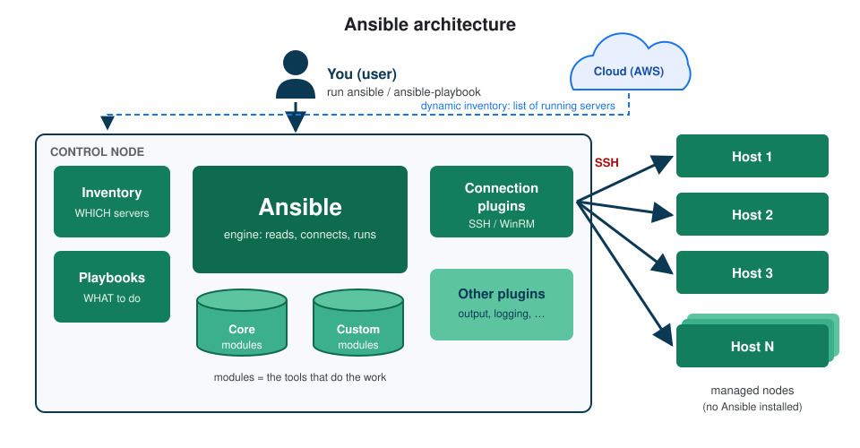

# Ansible Notes: From Zero to Playbooks

Simple, step-by-step Ansible notes for beginners. Every topic starts with a **definition**, explains the idea with **diagrams and tables**, and ends with a **hands-on lab** you can run yourself.

## About these notes

**Ansible** = an open-source automation tool that configures many servers at once over SSH, using simple YAML files called **playbooks**. Nothing is installed on the servers it manages.

| # | Topic | What you learn | Lab |
|---|---|---|---|
| 1 | [Introduction](01-introduction/README.md) | what Ansible is, key terms, architecture, how it connects over SSH, workflow, use cases | install Ansible, first ad-hoc command |
| 2 | [Inventory](02-inventory/README.md) | hosts, groups, host/group variables, INI vs YAML, **static vs dynamic** inventory | build and test an inventory |
| 3 | [Modules](03-modules/README.md) | what a module is, idempotency, how a module runs, module types | create and delete a user with the `user` module |
| 4 | [YAML & Playbooks](04-yaml-and-playbooks/README.md) | YAML rules, playbook structure, handlers, roles, best practices | install nginx with a playbook + handler |
| 5 | [Variables](05-variables/README.md) | where to define variables, types, special variables, precedence | override variables from many places |

**Interview questions:** [interview-questions.md](interview-questions.md)

## How to use these notes

Read the topics **in order**: each one builds on the one before.

Every topic follows the same structure:

| Section | What's inside |
|---|---|
| **About this topic** | one line + what is covered |
| **Part 1: Concepts** | definitions, diagrams, tables, examples (nothing to run) |
| **Part 2: Lab** | step by step, one command per box, with **What it does** and **Expected** |
| **What I learned** | the short summary |

## Lab setup

All labs run on **one Linux machine** with Ansible installed (an EC2 instance with Amazon Linux 2023 is perfect). Most labs use `localhost`, so you don't need extra servers to follow along.

For a full setup with **one control node and two managed nodes on AWS** (key pair, security groups, SSH, `ansible.cfg`), see the step-by-step lab in my other repo: [Ansible lab: control node + managed nodes](https://github.com/Abhignadumpala/devops-notes/blob/main/ansible-lab-control-node-managed-nodes/README.md).

## Quick reference

| Command | What it does |
|---|---|
| `ansible --version` | shows the Ansible version and which `ansible.cfg` is used |
| `ansible-inventory -i <inventory> --graph` | shows hosts and groups as a tree |
| `ansible <group> -i <inventory> -m ping` | checks Ansible can log in to the hosts |
| `ansible <group> -i <inventory> -m <module> -a "<args>"` | runs one module (ad-hoc command) |
| `ansible-playbook -i <inventory> <playbook>.yaml` | runs a playbook |
| `ansible-playbook <playbook>.yaml --syntax-check` | checks the YAML without running it |
| `ansible-playbook <playbook>.yaml --check` | dry run: shows what would change |
| `ansible-doc <module>` | shows the documentation and examples for a module |
